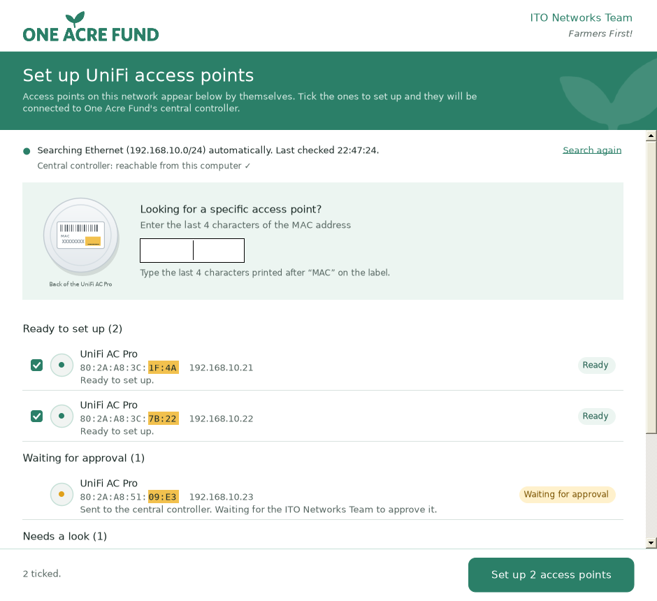

# UniFi Adoption Assistant — One Acre Fund ITO Networks Team

*Farmers First!*

A small Windows program that connects UniFi access points to One Acre Fund's central UniFi controller
(`http://unifi.oneacrefund.org:8080/inform`). Version 2 finds the access points on the network by
itself, sorts them into plain-language groups and sets up several at once. The ITO Networks Team then
approves them in the controller, and the list notices on its own when that has happened.



## Using it at a site

1. Plug in the access points (cable into the **POE** port of the power adapter, the adapter's **LAN**
   port into the site's switch) and connect this computer to the same network.
2. Open **UniFi Adoption Assistant**. Access points appear by themselves within a few seconds.
3. Access points that are ready are ticked automatically. Untick any you don't want, then click
   **Set up N access points**.
4. When it finishes, click **Copy message for the ITO Networks Team** and paste it into Teams or an
   email. Leave the window open: once the team approves, the access points move to **Already adopted**.

Looking for one particular access point? Type the last 4 characters of its MAC address in the search
box. The list then shows only that access point.

## The groups in the list

| Group | Meaning |
|---|---|
| **Ready to set up** | It accepts the factory password and isn't pointed at our controller yet. Ticked automatically |
| **Setting up** | Being set up right now, with a step-by-step note |
| **Waiting for approval** | It has our controller's address; the ITO Networks Team needs to approve it |
| **Needs a look** | Something needs attention; the sentence under it says what (for example "Not accepting setup connections yet") |
| **Checking** | Just found; being checked |
| **Already adopted** | Folded away by default. Rule agreed with the ITO Networks Team: **SSH is open but the factory password is refused**, which means the controller has adopted it |

Adopted access points are left alone. Each one gets a single read-only login check with the public
factory password. After that it isn't touched again unless someone clicks **Search again**.

## How it works

- **Finding access points:** Ubiquiti's discovery broadcast (UDP 10001) every 30 seconds, plus an ARP
  sweep of the local network every 2 minutes. Only Ubiquiti devices are listed. The traffic is light.
- **Checking (read-only):** port 22 is checked first, then the factory login is tried. If it works,
  `mca-cli-op info` tells us the access point's own status. Nothing is changed during a check.
- **Setting up:** the same per-device steps as version 1. Each access point is re-checked first. The
  device must confirm its own MAC address before anything is changed. Then `mca-cli-op set-inform`
  runs, with the old interactive `mca-cli` only as a fallback. Three access points at a time by
  default. Temporary failures are retried twice; stopping never cuts a command in half.
- **Approval:** access points waiting for approval are re-checked every 45 seconds. When the factory
  password stops working (with SSH still open), the access point moves to **Already adopted**.

The single-device logic from version 1 is still inside and fully tested. Every path uses one engine,
one device list keyed by MAC address, and the same safety checks.

## Building

On Windows with the [.NET 10 SDK](https://dotnet.microsoft.com/download) (it builds the .NET Framework
4.8 app) and, optionally, [Inno Setup 6](https://jrsoftware.org/isinfo.php) for the installer:

```powershell
./build/publish.ps1 -Version 2.0.0
```

The script:

- runs the tests on .NET Framework 4.8 and on .NET 10;
- builds `artifacts\UniFiAdoptionAssistant.exe`, a single file that runs on Windows 10 (version 1903
  or later) and Windows 11 without installing anything;
- builds the optional installer `UniFiAdoptionAssistant-Setup.exe` and `SHA256SUMS.txt`.

Version 2 targets .NET Framework 4.8, which is built into Windows, instead of carrying its own copy of
.NET. That is why the exe is a few megabytes instead of 48 MB. Costura packs the SSH library inside
the exe, so it is still one file.

GitHub Actions (`.github/workflows/build.yml`) does the same on every push and offers the exe and the
installer as separate downloads. Pushing a tag such as `v2.0.0` creates a GitHub release.

## Configuration

No settings file is needed. To change something, copy `settings.example.json` to `settings.json` next
to the exe, or to `C:\ProgramData\UniFiAdoptionAssistant\settings.json`. The main options:

| Setting | Default | Purpose |
|---|---|---|
| `InformUrl` | `http://unifi.oneacrefund.org:8080/inform` | Controller inform URL (strictly validated) |
| `SupportContact` | `the ITO Networks Team` | Used in messages |
| `BatchConcurrency` | `3` | Access points set up at the same time |
| `RecheckWaitingSeconds` | `45` | How often access points waiting for approval are checked |
| `DiscoveryIntervalSeconds` / `ArpSweepIntervalSeconds` | `30` / `120` | How often the list searches |
| `SupportedModelPrefixes` | `["UAP"]` | Use `["UAP-AC-Pro"]` to allow AC Pro only |
| `HostsFallbackControllerIp` | empty | Only for sites whose DNS can't resolve the controller name |
| `TestMode` | `false` | Check and show what would happen, without changing anything |

Device logins never go in settings. If one is ever needed, enter it under **Admin settings**. It is
stored encrypted for the current Windows user.

## Files on the user's computer

Under `%LOCALAPPDATA%\UniFiAdoptionAssistant`:

| Path | Contents |
|---|---|
| `logs\assistant-YYYYMMDD.log` | Diagnostic log, kept 30 days. Passwords are never written |
| `known-devices.json` | SSH fingerprints per access point MAC |
| `device-login.bin` | Optional login saved in Admin settings (DPAPI-encrypted) |

## Project layout

```
src/UniFiAdoption.Core       Engine: discovery, inventory, classification, checks, SSH, batches (net48 + net10.0)
src/UniFiAdoption.App        Windows Forms window (net48, single exe via Costura)
tests/UniFiAdoption.Tests    Unit, scenario, live-list, batch and real-SSH integration tests (net48 + net10.0)
tests/simulated-device       Simulated access point (dropbear + fake mca-cli-op) for integration tests
build/publish.ps1            Test, build, sign, installer, checksums
installer/                   Inno Setup script (per-user install)
docs/                        Architecture, deployment, test plan, limitations, changelog
```

## What has and hasn't been verified

Verified while building version 2:

- All 94 tests pass on .NET 10. They include the end-to-end test of the adoption rule with real
  SSH against a simulated access point: ready, then sent, then waiting for approval, then the password
  changes, then adopted.
- The engine compiles with zero warnings for .NET 10 and against .NET Framework 4.8 reference
  assemblies.
- The window was built for .NET Framework 4.8 and run under Mono with six simulated access points. The
  live list, search, batch, summary and approval detection all worked.

Not yet verified:

- Behaviour on real UniFi AC Pro firmware.
- The Windows-native .NET Framework build and the tests running on .NET Framework (CI does both).
- The final exe size.

Run the lab checklist in [docs/TEST-PLAN.md](docs/TEST-PLAN.md) before rollout.
