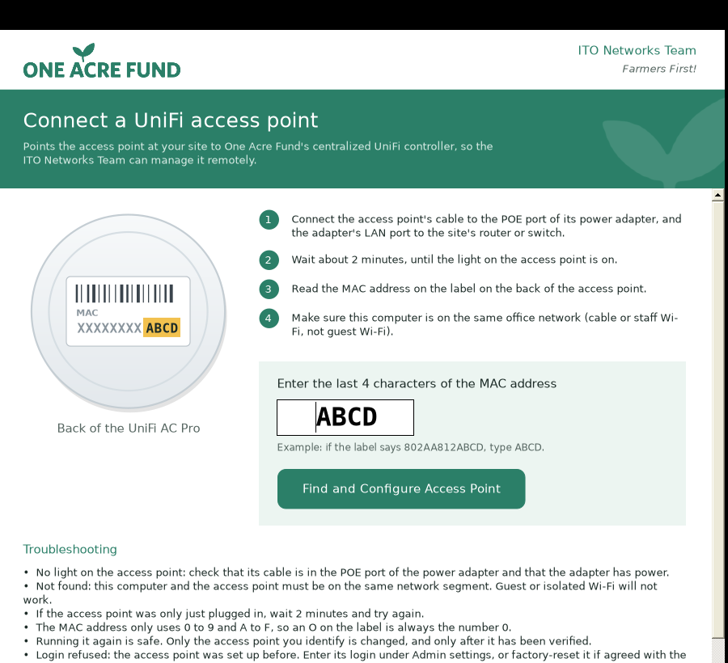

# UniFi Adoption Assistant — One Acre Fund ITO Networks Team

*Farmers First!*

Built by the One Acre Fund ITO Networks Team. A small Windows program that points a UniFi AC Pro access point at the central UniFi controller
(`http://unifi.oneacrefund.org:8080/inform`). The person at the site types the last four characters
of the access point's MAC address and clicks one button. The program finds that exact device on the
local network, checks it is the right one, logs in over SSH, sends the controller address, reads back
the device's status, and says in plain language what happened and what to do next.



## Using it at a site

1. Plug the access point's cable into the **POE** port of its power adapter, and connect the adapter's
   **LAN** port to the router or network switch. Wait about 2 minutes until its light is on.
2. Connect this computer to the same office network (cable or office Wi-Fi, not guest Wi-Fi).
3. Open **UniFi Adoption Assistant**, type the last 4 characters of the MAC address from the label on
   the back of the access point, and click **Find and Configure Access Point**.
4. Follow the message that appears. If asked, click **Copy support details** and send them to the ITO Networks Team.

Running it again is safe. It changes nothing unless exactly one matching UniFi device is found and
that device confirms its own MAC address.

## What it does, step by step

| Step | How | Changes the device? |
|---|---|---|
| Check the 4 characters | Hex only; plain-language hints (O→0, I/L→1) | No |
| Read this PC's networks | Active IPv4 adapters; VPN/virtual adapters skipped; self-assigned 169.254.x.x detected | No |
| Find devices | Ubiquiti discovery broadcast (UDP 10001) **and** an ARP sweep (Windows `SendARP`), in parallel. ARP works even if the device ignores ping | No |
| Pick the device | Exactly one MAC ending in the 4 characters; must answer Ubiquiti discovery or have a Ubiquiti OUI; must have exactly one reachable address | No |
| Check SSH | Reads the SSH banner without sending a password | No |
| Log in | IT-entered login (if any), then IT-saved login (if any), then the factory login `ubnt`/`ubnt` (if allowed). At most 3 attempts, only on the verified device | No |
| Check identity | Host key checked against the key remembered for that MAC; the device must report the expected MAC itself; model must start with `UAP` | No |
| Check name lookup | `ping -c 1 -W 2 '<controller>'` on the device, read only for name resolution | No |
| Configure | `mca-cli-op set-inform '<inform URL>'` (see below why not `mca-cli`) | **Yes** |
| Verify | Polls `mca-cli-op info` for up to 45 s and reports the device's own status | No |

Test mode (Admin settings, or start with `--test`) stops before "Configure" and shows the exact commands a
real run would send.

### About the legacy commands

The previous manual procedure was:

```
echo unifi.oneacrefund.org unifi >> /etc/hosts
mca-cli
set-inform http://unifi.oneacrefund.org:8080/inform
```

* **The `/etc/hosts` line has no effect.** A hosts line must start with an IP address
  (`203.0.113.10 unifi.oneacrefund.org`). `unifi.oneacrefund.org unifi` has none, so it is ignored. It
  also repeats each time the command is run and disappears when the access point restarts. The
  program does not touch `/etc/hosts` unless IT sets `HostsFallbackControllerIp`. Then it adds one
  correctly formatted line, only if the access point cannot resolve the name, and never duplicates it.
* **`mca-cli` is interactive** and does not work in a non-interactive SSH command. The program uses
  `mca-cli-op set-inform`, the non-interactive form. It falls back to driving an interactive
  `mca-cli` session in a pseudo-terminal only on firmware without `mca-cli-op`.

## Result messages

Each run ends in one outcome. The window shows a plain message and next steps; IT gets the details.

| Outcome | Meaning |
|---|---|
| Access point connected | The device itself reports *Connected* to the configured inform URL |
| Already connected | It already reported *Connected* to this controller; nothing was changed |
| Done here – waiting for IT to approve it | The device now reports the configured inform URL; adoption needs approval in the controller |
| Sent – IT needs to check it | Accepted, but the status could not be read back (interactive fallback) |
| Set up, but it can't reach / find the controller yet | URL set, but the device reports a timeout or cannot resolve the controller name |
| The controller refused the access point | Device reports a rejection |
| Check the characters | Invalid input |
| Access point not found / more than one device matches / not a UniFi access point / on a different network / more than one address | Discovery problems; nothing changed |
| Won't accept the setup connection / didn't accept the login / security check failed / device didn't match / can't be set up automatically | Problems before any change; nothing changed |
| The access point didn't take the controller address | `set-inform` was not confirmed |
| This computer blocked the search / isn't connected / settings problem / stopped / something went wrong | Local problems |

"Connected" is only reported when the access point says so; a successful SSH command is never
treated as adoption.

## Building

Requirements: Windows 10/11 with the [.NET 10 SDK](https://dotnet.microsoft.com/download), and
[Inno Setup 6](https://jrsoftware.org/isinfo.php) for the installer (optional).

```powershell
./build/publish.ps1 -Version 1.0.0
# with a pre-configured settings file and code signing:
./build/publish.ps1 -Version 1.0.0 -SettingsFile C:\it\settings.json -CertificatePath C:\certs\codesign.pfx -CertificatePassword (Read-Host -AsSecureString)
```

The script runs the tests and produces `artifacts\UniFiAdoptionAssistant.exe` (the whole app in one
file), the optional installer `artifacts\UniFiAdoptionAssistant-Setup.exe`, and `artifacts\SHA256SUMS.txt`.
GitHub Actions offers the exe and the installer as two separate downloads, so the app is not downloaded twice. Users need no .NET installation, no administrator rights and no
command prompt. The 32-bit build is deliberate: one file runs on 32-bit and 64-bit Windows 10/11.

The GitHub Actions workflow in `.github/workflows/build.yml` does the same on every push and creates a
GitHub release when a tag such as `v1.0.0` is pushed. See [docs/DEPLOYMENT.md](docs/DEPLOYMENT.md)
for hosting a stable download link.

Tests (any OS with the .NET 10 SDK):

```
dotnet run --project tests/UniFiAdoption.Tests -c Release
```

## Branding

The window uses the One Acre Fund logo green (#2B7F68), defined with the rest of the palette in
`src/UniFiAdoption.App/Theme.cs`. The logo (`Assets/logo.png`), the white leaf used as the header
watermark (`Assets/leaf-white.png`) and the leaf app icon (`Assets/app.ico`) were prepared from the
One Acre Fund logo and are built into the exe. To use a higher-resolution logo from the brand kit,
replace `Assets/logo.png` with a transparent PNG of the same shape.

## Size

The exe is about 48 MB because it carries its own copy of .NET 10, so nothing has to be installed on
the PC. Windows Forms apps cannot be safely trimmed in .NET 10. The way to get it down to a few MB is to
retarget the app to .NET Framework 4.8, which is already built into Windows 10 and 11. That is a
planned follow-up, to be done after the hardware tests pass.

## Configuration

Everything has a working default, so no settings file is required. To change something, copy
`settings.example.json` to `settings.json` next to the exe (or to
`C:\ProgramData\UniFiAdoptionAssistant\settings.json`). The first file found wins. The main options:

| Setting | Default | Purpose |
|---|---|---|
| `InformUrl` | `http://unifi.oneacrefund.org:8080/inform` | Controller inform URL (strictly validated) |
| `SupportContact` | `the ITO Networks Team` | Used in messages ("Contact the ITO Networks Team") |
| `AllowFactoryDefaultCredentials` | `true` | Try `ubnt`/`ubnt` on the verified device |
| `HostsFallbackControllerIp` | empty | Add `<ip> <host>` to the device's `/etc/hosts` if it can't resolve the name |
| `ExtraUbiquitiOuis` | `[]` | Extra Ubiquiti MAC prefixes to accept |
| `SupportedModelPrefixes` | `["UAP"]` | Use `["UAP-AC-Pro"]` to allow AC Pro only |
| `AllowInteractiveMcaCliFallback` | `true` | Legacy `mca-cli` session if `mca-cli-op` is missing |
| `VerifySeconds` | `45` | How long to watch the device status after `set-inform` |
| `PinnedHostKeys` | `{}` | Require a specific SSH host key for a MAC |
| `TestMode` | `false` | Start in test mode |
| `DeviceImagePath` | empty | Photo to show instead of the built-in drawing |

Device logins are never stored in settings. IT can enter one under **Admin settings**, for this session
or saved for the current Windows user (encrypted with Windows DPAPI).

## Files on the user's computer

| Path (under `%LOCALAPPDATA%\UniFiAdoptionAssistant`) | Contents |
|---|---|
| `logs\assistant-YYYYMMDD.log` | Diagnostic log; kept 30 days; passwords never written |
| `known-devices.json` | SSH host-key fingerprints per access point MAC |
| `device-login.bin` | Optional IT-saved login, DPAPI-encrypted |

## Troubleshooting (for IT)

* **Not found, but the access point is on:** is the PC on the same layer-2 network/VLAN (not guest
  Wi-Fi with client isolation)? Did the access point get a DHCP address? Without DHCP it uses
  192.168.1.20, which is reported as "on a different network" if its discovery reply is received.
* **Login refused:** the device was adopted before and uses the site's device credentials from its old
  controller. Enter them under Admin settings, or factory-reset the device (hold reset ~10 s).
* **Security check failed:** the device's SSH key changed, normally after a factory reset. Clear saved
  fingerprints in Admin settings.
* **Waiting for approval does not progress:** adopt the device in the controller. Also check the
  controller's *Inform Host override* (see the deployment guide).
* Every run is in the log; **Copy support details** puts a summary plus the recent log on the clipboard.

## Project layout

```
src/UniFiAdoption.Core      Engine (platform-neutral, fully tested): discovery, matching, SSH, commands, workflow
src/UniFiAdoption.App       Windows Forms window (presentation only)
tests/UniFiAdoption.Tests   Dependency-free test runner: unit, scenario and integration tests
tests/simulated-device      Simulated access point (dropbear + fake mca-cli-op) for integration tests
build/publish.ps1           Test, publish, sign, zip, installer, checksums
installer/                  Inno Setup script (per-user install)
docs/                       Architecture, deployment, test plan, limitations
```

## What has and has not been verified

Verified while building this release:

* The engine compiles with no warnings, and all 64 unit and scenario tests pass.
* 7 integration tests pass against a simulated access point. They use the real SSH.NET connector
  and real UDP discovery against dropbear, the SSH server UniFi firmware uses, with stand-in
  `mca-cli-op`/`mca-cli` scripts. They cover test mode, a real `set-inform`, host-key
  remembering, pinning and mismatch, wrong password, closed SSH port, unresolvable controller
  name, and the interactive `mca-cli` fallback over a pseudo-terminal.
* The window's source compiles against the WinForms API. It was rendered and exercised under
  Mono on Linux: initial screen, typing, result, test mode, and Admin settings.

**Not yet verified:**

* Behaviour on real UniFi AC Pro firmware. The output formats of `mca-cli-op` and the status wording
  are based on known UniFi behaviour, not on a device in this lab.
* The Windows ARP sweep on Windows.
* The .NET 10 Windows build, which is produced by the CI workflow.

Run the lab checklist in [docs/TEST-PLAN.md](docs/TEST-PLAN.md) before rollout. See
[docs/LIMITATIONS.md](docs/LIMITATIONS.md).
